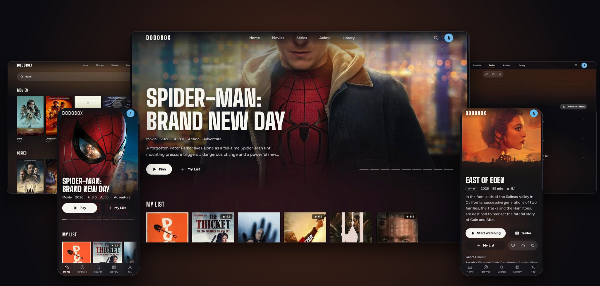

# Dodobox

[](https://github.com/dodoflix/dodobox/actions/workflows/ci.yml)
[](https://github.com/dodoflix/dodobox/releases)
[](LICENSE)

A self-hosted streaming app for movies, series and anime. Pick a title, press play. Works on phones, laptops and TVs on your home network, with a profile for each person.

<p align="center"></p>

Start it (needs [Node.js](https://nodejs.org) 24+):

```sh
npm install && npm start
```

Or download an installer for Windows, macOS or Linux from the [releases](https://github.com/dodoflix/dodobox/releases), or run the container: `docker run --network host -v dodobox:/data ghcr.io/dodoflix/dodobox`

It prints an address for your phone and TV. Dodobox has no login, so keep it on a network you trust.

Also: watch parties with chat, subtitles that sync and translate themselves, quality that adapts to your connection, and an Android TV app.

- [Using Dodobox](docs/usage.md)
- [How it works](docs/architecture.md)
- [Benchmarks](docs/benchmarks.md) and the [backend decisions](docs/backend-decisions.md)
- [Android TV app](apps/android/README.md)
- [Contributing](CONTRIBUTING.md) and [security policy](SECURITY.md)

Use it only for content you are allowed to download and watch. See the [legal notice](LEGAL.md).
